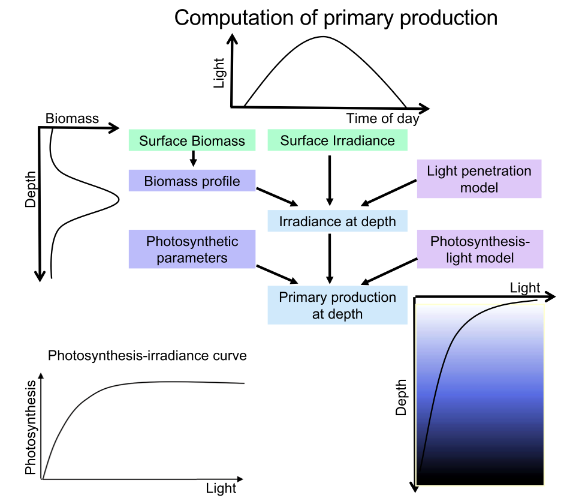

# PSM_spectral_PP_model

**PSM spectral Primary Production Model**: a compact Python implementation
of the Platt–Sathyendranath model of ocean primary production. It is
spectrally resolved (400–700 nm) and resolves depth and time of day. It is
driven by satellite surface chlorophyll‑a and daily photosynthetically
available radiation (PAR).

[](https://primaryproduction.github.io/PSM_spectral_PP_model/)
[](https://mybinder.org/v2/gh/PrimaryProduction/PSM_spectral_PP_model/HEAD?labpath=light_field.ipynb)

The model was developed for the CBIOMES primary production workshop. It is
the spectral companion to the non-spectral practical in
[PrimaryProduction/Non_spectral_PP_model](https://github.com/PrimaryProduction/Non_spectral_PP_model),
and follows the formulation used for the global estimates of
[Kulk et al. (2020)](https://doi.org/10.3390/rs12050826).

**Full documentation:** <https://primaryproduction.github.io/PSM_spectral_PP_model/>
(model description with equations, tutorial, API reference, known issues and
references). It can also be built and browsed locally, see
[Documentation](#documentation).

---

## Contents

- [What the model does](#what-the-model-does)
- [Repository contents](#repository-contents)
- [Installation](#installation)
- [Quick start](#quick-start)
- [Model overview](#model-overview)
- [Running on Binder or WEkEO](#running-on-binder-or-wekeo)
- [Documentation](#documentation)
- [Known issues](#known-issues)
- [References](#references)

## What the model does

From surface chlorophyll‑a and daily PAR at a location and date, the model
computes:

1. a **chlorophyll profile** $B(z)$ with a Gaussian deep chlorophyll maximum,
2. the partition of chlorophyll into **pico-, nano- and microplankton**, and
   the resulting **phytoplankton absorption spectrum** $a_{ph}(z,\lambda)$,
3. **solar geometry** (declination, zenith angle, sunrise, day length),
4. the **clear-sky spectral irradiance** at the surface (direct and diffuse),
   corrected for clouds and surface reflection and scaled to satellite PAR,
5. the **underwater spectral light field** $E_d(z,\lambda,t)$ from the
   absorption and backscattering of water, phytoplankton and CDOM, and
6. **primary production** $P(z,t)$ from a spectral photosynthesis–irradiance
   function, which can be integrated over depth and the day.



## Repository contents

| File | Description |
|---|---|
| `light_field.ipynb` | Notebook walking through the model step by step |
| `config.py` | Default wavelength grid (400–700 nm, 5 nm), depth grid (0–250 m, 0.5 m) and constants |
| `chlorophyll.py` | Shifted-Gaussian chlorophyll profile (Lewis et al. 1983; Platt et al. 1988) |
| `size_fraction.py` | Three-component size-class model (Brewin et al. 2010) |
| `absorption.py` | Phytoplankton absorption from size-specific spectra (Brewin et al. 2011) |
| `scatter.py` | Pure-water absorption (Pope & Fry 1997) and scattering (Morel 1974), Raman scattering (Bartlett et al. 1998), CDOM spectral shape (Bricaud et al. 1981) |
| `daylight.py` | Solar declination (Spencer 1971), zenith angle, sunrise, day length (Brock 1981) |
| `irradiance.py` | Clear-sky spectral direct and diffuse irradiance (Bird 1984; Bird & Riordan 1986) |
| `surface_light.py` | Below-surface spectral irradiance at an instant, scaled to satellite PAR |
| `light_profile.py` | Diffuse attenuation and the underwater light field (Sathyendranath & Platt 1988) |
| `pyproject.toml` | Project metadata and the [pixi](https://pixi.sh) environments |
| `requirements.txt` | Minimal pip requirements (for Binder/WEkEO) |
| `mkdocs.yml`, `docs/` | Documentation website sources |
| `.github/workflows/docs.yml` | Builds the documentation and deploys it to GitHub Pages |

## Installation

### With pixi (recommended)

```bash
git clone https://github.com/PrimaryProduction/PSM_spectral_PP_model.git
cd PSM_spectral_PP_model
pixi install
pixi run notebook          # opens light_field.ipynb in JupyterLab
```

### With pip

The model needs only `numpy`, `scipy` and `pandas` (`matplotlib` for the
notebook). Python ≥ 3.11 is recommended.

```bash
python -m venv .venv && source .venv/bin/activate
pip install -r requirements.txt jupyterlab
pip install -e .           # optional: import the modules from anywhere
```

The code consists of flat modules (`import daylight`, `import surface_light`,
…). Run from the repository root or install with `pip install -e .`.

## Quick start

Daily primary production at 45° N on 6 May for a surface chlorophyll of
1.5 mg m⁻³ and a daily PAR of 25 einstein m⁻² d⁻¹:

```python
import numpy as np
import pandas as pd

import absorption, chlorophyll, config, daylight, light_profile, scatter, surface_light

lat, par = 45.0, 25.0                                  # deg N, einstein m-2 d-1
day = pd.Timestamp("2020-05-06")

chlz = chlorophyll.sinusodal_profile(1.5, rho=0.1)     # B(z), mg m-3
ac, _ = absorption.calc_ac(chlz)                       # a_ph(z, lambda), m-1
d_lambda = scatter.all()["d_lambda"]                   # band widths, nm

Pb_m, Al_b = 6.0, 0.02                                 # P-I parameters
alpha_spec = Al_b * ac * 6022.0 / (2.77 * 36.0 * ac.mean(axis=1)[:, None])

times = daylight.time_range(day, lat, zenith_deg=80, steps=11)
pp = []
for t in times:
    irs = surface_light.instant(t, lat, par)           # below-surface spectra
    zen = np.rad2deg(daylight.zenith(t, lat))
    irz = light_profile.compute_profile(chlz, zen, irs["direct"], irs["diffuse"])
    I_alpha = np.sum(d_lambda * alpha_spec * irz["Iz"] / irz["mu_d"], axis=1)
    pp.append(chlz * Pb_m * (1 - np.exp(-I_alpha / Pb_m)))   # mg C m-3 h-1

hours = (times - times[0]).total_seconds().to_numpy() / 3600
daily = np.trapezoid(np.trapezoid(pp, hours, axis=0), config.depths)
print(f"{daily:.0f} mg C m-2 d-1")                     # -> 354 mg C m-2 d-1
```

See the [tutorial](https://primaryproduction.github.io/PSM_spectral_PP_model/tutorial/)
for a step-by-step version.

## Model overview

Primary production is the product of biomass and the chlorophyll-normalised
rate given by a photosynthesis–irradiance (P–I) function
([Platt et al. 1980](https://images.peabody.yale.edu/publications/jmr/jmr38-04-06.pdf)):

$$
P(z,t) = B(z)\,P^B_m\left[1 - \exp\left(-\frac{I^\alpha(z,t)}{P^B_m}\right)\right],
\qquad
I^\alpha = \sum_\lambda \alpha^B(z,\lambda)\,\frac{E_d(z,\lambda,t)}{\mu_d(\lambda)}\,\Delta\lambda .
$$

The ingredients:

- **Chlorophyll profile.** $B(z) = B_0 + \frac{h}{\sigma\sqrt{2\pi}}\exp[-(z-z_m)^2/2\sigma^2]$,
  scaled so that $B(0)$ equals the satellite value
  ([Lewis et al. 1983](https://doi.org/10.1029/JC088iC04p02565);
  [Platt et al. 1988](https://doi.org/10.1016/0198-0149(88)90064-7)).
- **Size classes and absorption.** Chlorophyll is split into pico, nano and
  micro fractions ([Brewin et al. 2010](https://doi.org/10.1016/j.ecolmodel.2010.02.014)),
  each with its own specific absorption spectrum
  ([Brewin et al. 2011](https://doi.org/10.1364/AO.50.004535)).
- **Spectral initial slope.** $\alpha^B(z,\lambda) = \alpha^B a_{ph}(z,\lambda)/\overline{a_{ph}}(z)$,
  so light is weighted by how strongly phytoplankton absorb it
  ([Sathyendranath et al. 1989](https://doi.org/10.1016/0198-0149(89)90046-0)).
- **Surface light.** The spectral shape and the direct/diffuse split come from
  the clear-sky model of [Bird (1984)](https://doi.org/10.1016/0038-092X(84)90260-3),
  with a cloud correction and Fresnel reflection. The magnitude comes from
  satellite PAR, distributed sinusoidally over the day
  ([Platt & Sathyendranath 1988](https://doi.org/10.1126/science.241.4873.1613)).
- **Underwater light.** $K_d = (a + b_b)/\mu_d$ with absorption by water,
  phytoplankton, CDOM and Raman scattering, and backscattering by water and
  particles ([Sathyendranath & Platt 1988](https://doi.org/10.1029/JC093iC08p09270)).

The [model description](https://primaryproduction.github.io/PSM_spectral_PP_model/theory/)
gives every equation with its source, and the
[API reference](https://primaryproduction.github.io/PSM_spectral_PP_model/api/)
documents each function's arguments, units and return values.

## Running on Binder or WEkEO

- **Binder:** click the badge above. It is quick to try, but sessions are
  temporary.
- **WEkEO JupyterHub:** a free, persistent JupyterLab environment from the EU
  Copernicus programme. Register at <https://wekeo.copernicus.eu/register>,
  start a server from <https://wekeo.copernicus.eu/my-wekeo>, open a terminal
  and run

  ```bash
  git clone https://github.com/PrimaryProduction/PSM_spectral_PP_model.git
  cd PSM_spectral_PP_model
  pip install --user -r requirements.txt
  ```

  Then open `light_field.ipynb`. The
  [Non-spectral practical README](https://github.com/PrimaryProduction/Non_spectral_PP_model#running-the-practical-on-wekeo)
  has a detailed step-by-step guide.

## Documentation

The documentation is built with [MkDocs](https://www.mkdocs.org/),
[Material for MkDocs](https://squidfunk.github.io/mkdocs-material/) and
[mkdocstrings](https://mkdocstrings.github.io/). The API pages are generated
from the numpydoc docstrings in the code.

```bash
pixi run -e docs docs-serve    # live local preview at http://127.0.0.1:8000
pixi run -e docs docs-build    # static site in ./site/ (open site/index.html)
pixi run -e docs python docs/scripts/make_figures.py   # regenerate figures
```

Without pixi: `pip install mkdocs mkdocs-material "mkdocstrings[python]"` and
run `mkdocs serve`.

**GitHub Pages:** `.github/workflows/docs.yml` runs the docstring examples,
builds the site and deploys it on every push to `main`. Enable it once under
*Settings → Pages → Source: GitHub Actions*. Alternatively, run
`pixi run -e docs mkdocs gh-deploy`.

**Tests:** every docstring has runnable examples:

```bash
pixi run python -m doctest *.py
```

## Known issues

The documentation describes the code as it is and does not change its
behaviour. A few points to be aware of (details on the
[Known issues](https://primaryproduction.github.io/PSM_spectral_PP_model/known-issues/)
page):

- `daylight.thekaekara` extrapolates the annual top-of-atmosphere table after
  day 23. The value cancels in `surface_light.instant`, so model output is
  unaffected.
- The aerosol band split in `irradiance.Irradiance` is index-based and falls
  at 450 nm on the default grid instead of 500 nm.
- `surface_light.instant` is only valid between sunrise and sunset.
- `chlorophyll.sinusodal_profile` returns a Gaussian profile despite its name.

## References

- Bird, R.E. (1984). A simple, solar spectral model for direct-normal and diffuse horizontal irradiance. *Solar Energy*, 32(4), 461–471. https://doi.org/10.1016/0038-092X(84)90260-3
- Bird, R.E. & Riordan, C. (1986). Simple solar spectral model for direct and diffuse irradiance on horizontal and tilted planes at the Earth's surface for cloudless atmospheres. *J. Climate Appl. Meteor.*, 25(1), 87–97. https://doi.org/10.1175/1520-0450(1986)025%3C0087:SSSMFD%3E2.0.CO;2
- Brewin, R.J.W. et al. (2010). A three-component model of phytoplankton size class for the Atlantic Ocean. *Ecological Modelling*, 221(11), 1472–1483. https://doi.org/10.1016/j.ecolmodel.2010.02.014
- Brewin, R.J.W. et al. (2011). Model of phytoplankton absorption based on three size classes. *Applied Optics*, 50(22), 4535–4549. https://doi.org/10.1364/AO.50.004535
- Brewin, R.J.W. et al. (2015). Influence of light in the mixed layer on the parameters of a three-component model of phytoplankton size class. *J. Geophys. Res. Oceans*, 120. https://doi.org/10.1002/2014JC009859
- Bricaud, A., Morel, A. & Prieur, L. (1981). Absorption by dissolved organic matter of the sea (yellow substance) in the UV and visible domains. *Limnol. Oceanogr.*, 26(1), 43–53. https://doi.org/10.4319/lo.1981.26.1.0043
- Kulk, G. et al. (2020). Primary production, an index of climate change in the ocean: satellite-based estimates over two decades. *Remote Sensing*, 12(5), 826. https://doi.org/10.3390/rs12050826
- Lewis, M.R., Cullen, J.J. & Platt, T. (1983). Phytoplankton and thermal structure in the upper ocean: consequences of nonuniformity in chlorophyll profile. *J. Geophys. Res.*, 88(C4), 2565–2570. https://doi.org/10.1029/JC088iC04p02565
- Loisel, H. & Morel, A. (1998). Light scattering and chlorophyll concentration in case 1 waters: a reexamination. *Limnol. Oceanogr.*, 43(5), 847–858. https://doi.org/10.4319/lo.1998.43.5.0847
- Longhurst, A., Sathyendranath, S., Platt, T. & Caverhill, C. (1995). An estimate of global primary production in the ocean from satellite radiometer data. *J. Plankton Res.*, 17(6), 1245–1271. https://doi.org/10.1093/plankt/17.6.1245
- Morel, A. & Smith, R.C. (1974). Relation between total quanta and total energy for aquatic photosynthesis. *Limnol. Oceanogr.*, 19(4), 591–600. https://doi.org/10.4319/lo.1974.19.4.0591
- Platt, T., Gallegos, C.L. & Harrison, W.G. (1980). Photoinhibition of photosynthesis in natural assemblages of marine phytoplankton. *J. Mar. Res.*, 38, 687–701.
- Platt, T. & Sathyendranath, S. (1988). Oceanic primary production: estimation by remote sensing at local and regional scales. *Science*, 241(4873), 1613–1620. https://doi.org/10.1126/science.241.4873.1613
- Platt, T., Sathyendranath, S., Caverhill, C.M. & Lewis, M.R. (1988). Ocean primary production and available light: further algorithms for remote sensing. *Deep-Sea Res.*, 35(6), 855–879. https://doi.org/10.1016/0198-0149(88)90064-7
- Pope, R.M. & Fry, E.S. (1997). Absorption spectrum (380–700 nm) of pure water. II. Integrating cavity measurements. *Applied Optics*, 36(33), 8710–8723. https://doi.org/10.1364/AO.36.008710
- Sathyendranath, S. & Platt, T. (1988). The spectral irradiance field at the surface and in the interior of the ocean: a model for applications in oceanography and remote sensing. *J. Geophys. Res.*, 93(C8), 9270–9280. https://doi.org/10.1029/JC093iC08p09270
- Sathyendranath, S., Platt, T., Caverhill, C.M., Warnock, R.E. & Lewis, M.R. (1989). Remote sensing of oceanic primary production: computations using a spectral model. *Deep-Sea Res.*, 36(3), 431–453. https://doi.org/10.1016/0198-0149(89)90046-0
- Ulloa, O., Sathyendranath, S. & Platt, T. (1994). Effect of the particle-size distribution on the backscattering ratio in seawater. *Applied Optics*, 33(30), 7070–7077. https://doi.org/10.1364/AO.33.007070

The complete bibliography is on the
[References](https://primaryproduction.github.io/PSM_spectral_PP_model/references/)
page.

## Author

Bror Jönsson (brorfred@gmail.com), with contributions from the CBIOMES
primary production workshop. The non-spectral companion practical was
developed by Bob Brewin (University of Exeter).
