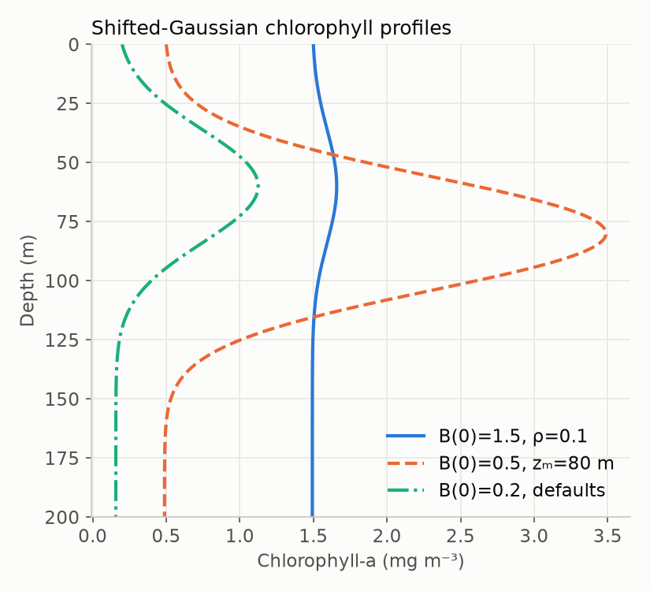
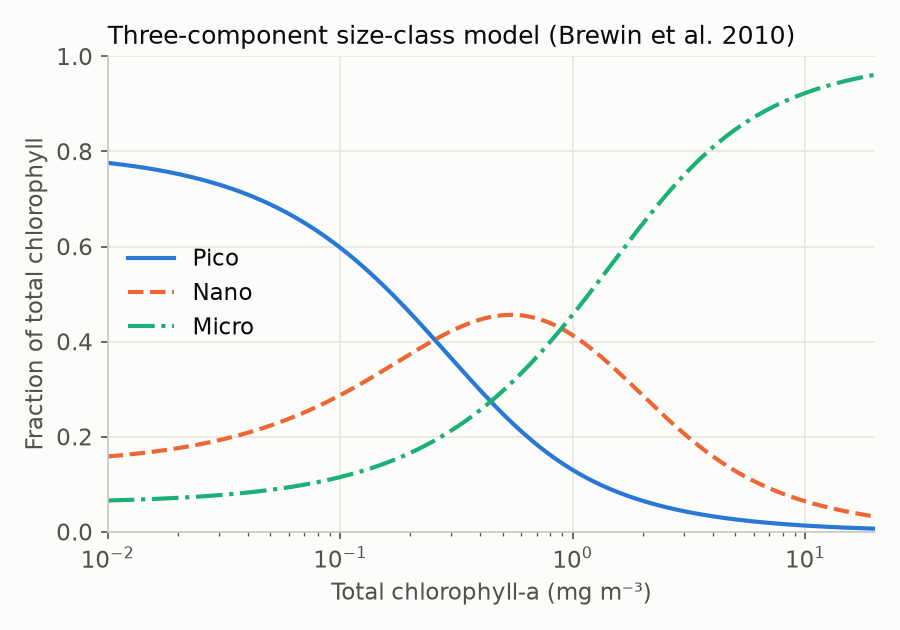
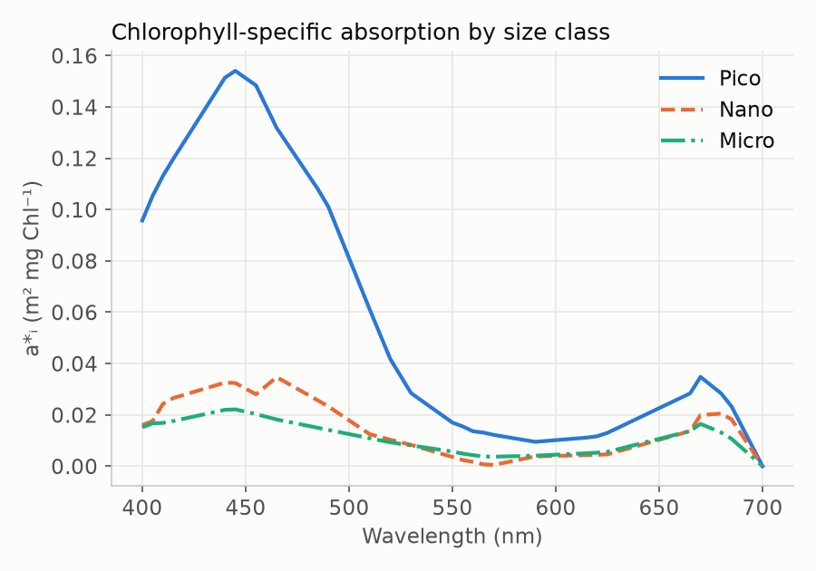
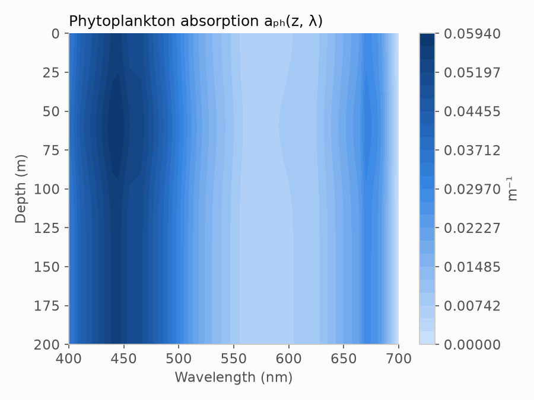

# Chlorophyll profile and size classes

## Vertical structure

Satellite ocean-colour sensors see chlorophyll only in roughly the first
optical depth (the layer above the 37 % light level, often only a few metres).
In stratified waters, however, much of the phytoplankton biomass sits in a
**deep chlorophyll maximum** (DCM) well below that layer. Ignoring it can bias
water-column production considerably
([Platt et al. 1988](../references.md#platt1988b)).

The model therefore uses the **shifted Gaussian** profile of
[Lewis et al. (1983)](../references.md#lewis1983) and
[Platt et al. (1988)](../references.md#platt1988b):

$$
B(z) = B_0 + \frac{h}{\sigma\sqrt{2\pi}}
       \exp\!\left[-\frac{(z - z_m)^2}{2\sigma^2}\right],
$$

with

| Symbol | Meaning | Default | Unit |
|---|---|---|---|
| $B_0$ | background chlorophyll | derived | mg m⁻³ |
| $h$ | chlorophyll in the peak (integral of the Gaussian) | derived | mg m⁻² |
| $z_m$ | depth of the chlorophyll maximum | 60 | m |
| $\sigma$ | width of the peak | 24 | m |
| $\rho$ | peak height relative to total chlorophyll at $z_m$ | 0.86 | – |

The implementation parameterises the peak by
$\rho = H/(H+B_0)$, where $H=h/(\sigma\sqrt{2\pi})$ is the peak height, and
chooses $B_0$ so that the profile equals the satellite value at the surface,
$B(0)=B_\text{sat}$:

$$
B_0 = \frac{B_\text{sat}}{1 + \dfrac{\rho}{1-\rho}\,
      \exp\!\left(-\dfrac{z_m^2}{2\sigma^2}\right)},
\qquad
h = \sigma\,\frac{\rho}{1-\rho}\,B_0\sqrt{2\pi}.
$$

$\rho\to 0$ gives a uniform (well-mixed) profile. Profile parameters vary
with region and season. [Longhurst et al. (1995)](../references.md#longhurst1995)
tabulated them for each of their biogeochemical provinces, and
[Kulk et al. (2020)](../references.md#kulk2020) used an updated set for the
global analysis.

{ .figure width="460" }

Implemented in [`chlorophyll.sinusodal_profile`](../api/chlorophyll.md). Despite
the name, the function returns a Gaussian, not a sinusoidal, profile.

## Phytoplankton size classes

The absorption spectrum of a phytoplankton community depends on the size of
its cells. Large cells pack pigments more densely, so each molecule of
chlorophyll is partly shaded by others (the **package effect**), and their
accessory-pigment composition differs. Both effects flatten and lower the
chlorophyll-specific absorption spectrum
([Ciotti et al. 2002](../references.md#ciotti2002)). Because large cells
dominate as chlorophyll increases, community size structure can be predicted
from total chlorophyll.

The three-component model of
[Brewin et al. (2010)](../references.md#brewin2010) gives the chlorophyll in
picoplankton ($<2$ µm, $C_p$), nanoplankton (2–20 µm, $C_n$) and
microplankton ($>20$ µm, $C_m$):

$$
C_{p,n} = C^m_{p,n}\left[1 - e^{-S_{p,n}C}\right],\qquad
C_p = C^m_p\left[1 - e^{-S_pC}\right],
$$

$$
C_n = C_{p,n} - C_p,\qquad C_m = C - C_{p,n},
$$

with $C^m_{p,n}=0.77$, $S_{p,n}=0.94/0.77$, $C^m_p = 0.13$ and
$S_p = 0.80/0.13$ (mg m⁻³ and (mg m⁻³)⁻¹). The asymptotes $C^m$ are the
maximum chlorophyll the small size classes can reach. Above them, extra
chlorophyll goes into larger cells. See
[Brewin et al. (2015)](../references.md#brewin2015) for how the parameters
depend on light in the mixed layer.

{ .figure width="520" }

Implemented in [`size_fraction.brewin`](../api/size_fraction.md).

## Phytoplankton absorption

The total phytoplankton absorption coefficient is the chlorophyll-weighted sum
of size-specific spectra
([Brewin et al. 2011](../references.md#brewin2011)):

$$
a_{ph}(z,\lambda) = C_p(z)\,a^*_p(\lambda) + C_n(z)\,a^*_n(\lambda)
                  + C_m(z)\,a^*_m(\lambda).
$$

{ .figure width="520" }

Because $C_p$, $C_n$ and $C_m$ change with depth along the chlorophyll
profile, $a_{ph}$ changes both in magnitude and in spectral shape with depth:

{ .figure width="520" }

Implemented in [`absorption.calc_ac`](../api/absorption.md). The specific
spectra are tabulated at 5 nm in `absorption.PICO`, `NANO` and `MICRO`.
