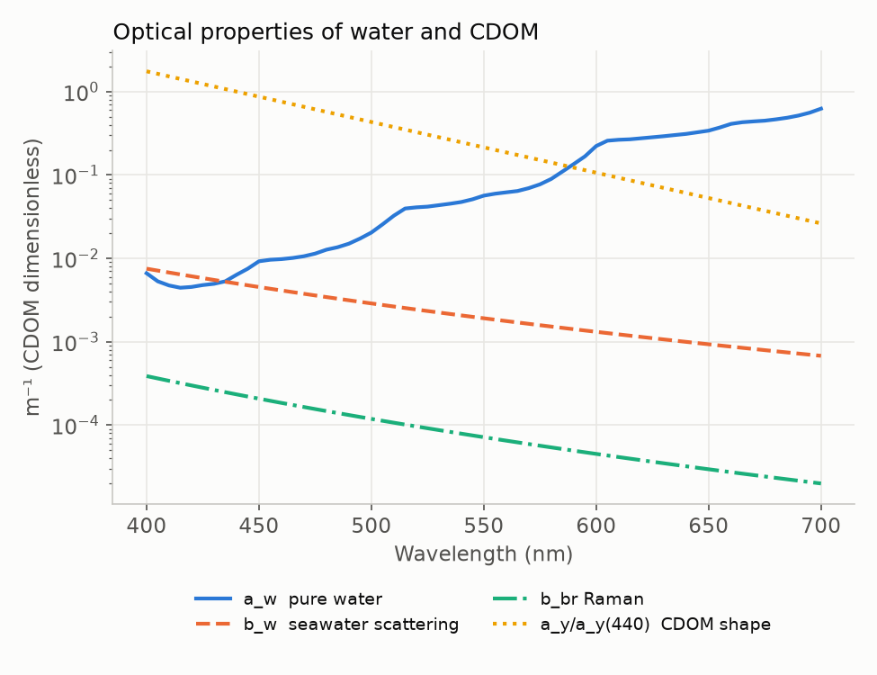
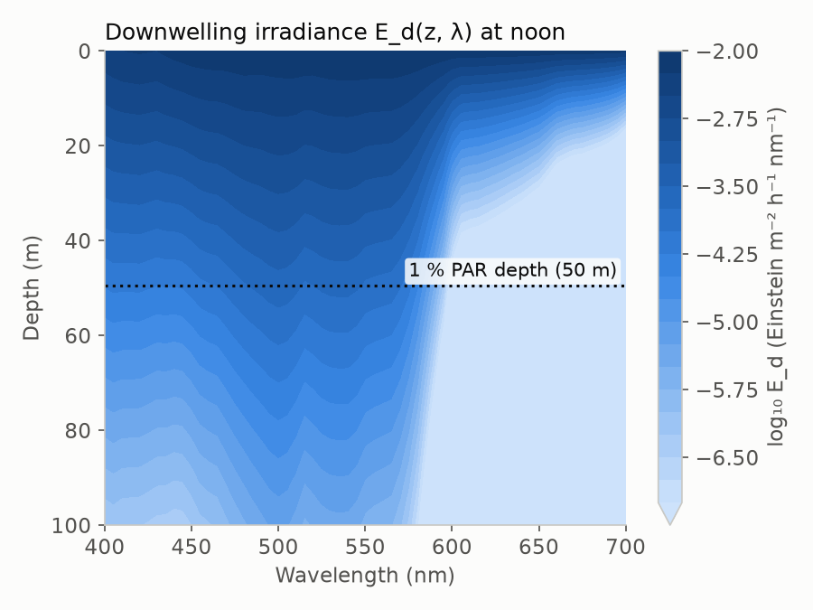

# Underwater light field

Light below the surface is attenuated by absorption and scattering. The model
follows [Sathyendranath & Platt (1988)](../references.md#sathyendranath1988)
and computes the **diffuse attenuation coefficient for downwelling
irradiance** from the inherent optical properties (IOPs) of the water and its
constituents, using the approximation

$$
K_d(z,\lambda) \approx \frac{a(z,\lambda) + b_b(z,\lambda)}{\mu_d(\lambda)},
$$

where $a$ is the total absorption coefficient, $b_b$ the total backscattering
coefficient and $\mu_d$ the mean cosine of the downwelling light
([Kirk 2011](../references.md#kirk2011); [Mobley 1994](../references.md#mobley1994)).
Implemented in [`light_profile.compute_profile`](../api/light_profile.md).

## Mean cosine

The direct beam travels at the refracted angle
$\theta_w = \arcsin(\sin\theta_s/1.333)$. Diffuse light is assigned a mean
cosine of 0.831 ([Sathyendranath & Platt 1988](../references.md#sathyendranath1988)).
The mean cosine just below the surface is the irradiance-weighted average:

$$
\mu_d(\lambda) = \frac{E_\text{dir}\cos\theta_w + 0.831\,E_\text{dif}}{E_\text{dir}+E_\text{dif}}.
$$

The model keeps it constant with depth.

## Absorption

$$
a(z,\lambda) = a_w(\lambda) + a_{ph}(z,\lambda) + a_y(z,440)\,e^{-0.014(\lambda-440)} + 2\,b_{br}(\lambda).
$$

| Term | Description | Source |
|---|---|---|
| $a_w$ | pure water | [Pope & Fry 1997](../references.md#pope1997) |
| $a_{ph}$ | phytoplankton, from the size-class model | [Brewin et al. 2011](../references.md#brewin2011) |
| $a_y$ | CDOM, exponential slope 0.014 nm⁻¹ | [Bricaud et al. 1981](../references.md#bricaud1981) |
| $b_{br}$ | Raman scattering, counted as a loss | [Bartlett et al. 1998](../references.md#bartlett1998) |

Following the Case-1 assumption
([Prieur & Sathyendranath 1981](../references.md#prieur1981);
[Morel 1988](../references.md#morel1988)), CDOM co-varies with phytoplankton:
$a_y(440) = Y\,a_{ph}(440)$, with $Y$ = `yellow_substance` = 0.3 by default.

## Scattering and backscattering

Pure seawater scatters as $b_w(\lambda) = 0.00288\,(\lambda/500)^{-4.3}$ m⁻¹,
half of it backwards ([Morel 1974](../references.md#morel1974b)). Particle
scattering follows [Loisel & Morel (1998)](../references.md#loisel1998) at
660 nm, with a spectral slope that decreases as chlorophyll increases:

$$
b_p(\lambda) = 0.407\,B^{0.795}\left(\frac{660}{\lambda}\right)^{-\log_{10}B}.
$$

The particle backscattering ratio decreases with chlorophyll
([Ulloa et al. 1994](../references.md#ulloa1994)) and is bounded to
$[0.0005, 0.01]$:

$$
\tilde b_b = 0.0078 - 0.0042\log_{10}B,\qquad
b_b = \tilde b_b\,b_p + 0.5\,b_w.
$$

{ .figure width="560" }

## Propagation

Starting from the total irradiance just below the surface,
$E_d(0^-,\lambda) = E_\text{dir}+E_\text{dif}$, light is attenuated layer by
layer (Beer–Lambert within each layer):

$$
E_d(z_i,\lambda) = E_d(z_{i-1},\lambda)\,\exp\!\left[-K_d(z_i,\lambda)\,\Delta z_i\right].
$$

Spectral integration gives PAR at each depth,
$\text{PAR}(z) = \sum_\lambda E_d(z,\lambda)\,\Delta\lambda$, and the
**euphotic depth** is the deepest level at which PAR is at least 1 % of its
surface value.

{ .figure width="520" }

*Downwelling irradiance (log scale) at noon for the profile with
$B(0) = 1.5$ mg m⁻³ and $\rho = 0.1$, at 45° N on 6 May. Red light is
absorbed by water within the top few metres. Blue-green light (around
490–560 nm) penetrates deepest, and phytoplankton absorption makes the blue
end fade faster than in clear water.*
