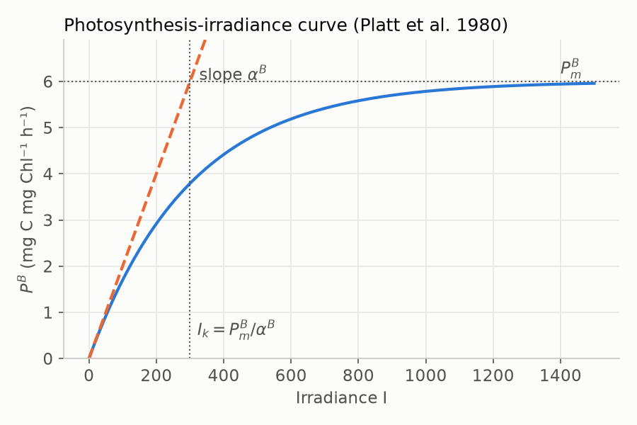
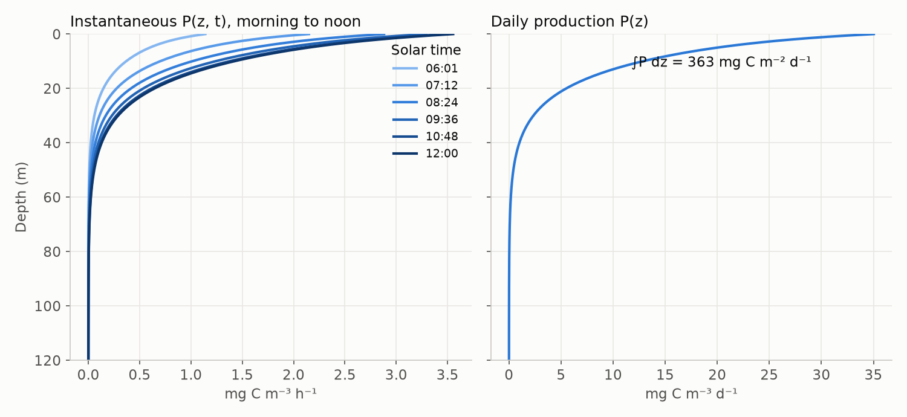

# Primary production

## The photosynthesis–irradiance (P–I) function

Chlorophyll-normalised production saturates with increasing light. The model
uses the exponential form of [Platt et al. (1980)](../references.md#platt1980)
without photoinhibition:

$$
P^B = P^B_m\left[1 - \exp\!\left(-\frac{\alpha^B I}{P^B_m}\right)\right],
$$

where $P^B_m$ is the **assimilation number** (light-saturated rate,
mg C (mg Chl)⁻¹ h⁻¹) and $\alpha^B$ the **initial slope**. Their ratio
$I_k = P^B_m/\alpha^B$ is the light-saturation parameter.

{ .figure width="500" }

In nature $P^B_m$ ranges from roughly 0.2 to 25 mg C (mg Chl)⁻¹ h⁻¹,
depending on region, season, temperature and nutrient supply.
[Bouman et al. (2018)](../references.md#bouman2018) compiled a global data set
of several thousand P–I experiments, which
[Kulk et al. (2020)](../references.md#kulk2020) used to assign parameters by
province and season. The examples on this site use $P^B_m = 6$ and
$\alpha^B = 0.02$, the same values as the non-spectral practical.

## Spectral light utilisation

Phytoplankton absorb light more efficiently at some wavelengths than at
others, so a spectral model makes the initial slope wavelength-dependent. It
is scaled by the shape of the phytoplankton absorption spectrum
([Sathyendranath et al. 1989](../references.md#sathyendranath1989);
[Kyewalyanga et al. 1992](../references.md#kyewalyanga1992)):

$$
\alpha^B(z,\lambda) = \alpha^B\,\frac{a_{ph}(z,\lambda)}{\overline{a_{ph}}(z)}\,f_u,
$$

where $\overline{a_{ph}}$ is the spectral mean of $a_{ph}$ (from
`absorption.calc_ac`) and $f_u$ converts the units of $\alpha^B$. The
broadband slope is given per W m⁻² (mg C (mg Chl)⁻¹ h⁻¹ (W m⁻²)⁻¹), while the
irradiance in the model is in einstein m⁻² h⁻¹. With
$1\ \text{W m}^{-2}\approx 2.77\times10^{18}$ quanta m⁻² s⁻¹ for PAR
([Morel & Smith 1974](../references.md#morel1974)):

$$
f_u = \frac{6.022\times 10^{23}}{2.77\times 10^{18}\times 3600}
    = \frac{6022}{2.77\times 36} \approx 60.4\ \text{W m}^{-2}\,\text{per einstein m}^{-2}\,\text{h}^{-1}.
$$

The light term in the P–I function is the spectrally weighted, absorbed
irradiance. Downwelling irradiance is converted to scalar irradiance by
dividing by the mean cosine, because a phytoplankton cell absorbs light
arriving from all directions:

$$
I^\alpha(z,t) = \sum_\lambda \alpha^B(z,\lambda)\,
                \frac{E_d(z,\lambda,t)}{\mu_d(\lambda)}\,\Delta\lambda,
$$

and production at depth $z$ and time $t$ is

$$
P(z,t) = B(z)\,P^B_m\left[1 - \exp\!\left(-\frac{I^\alpha(z,t)}{P^B_m}\right)\right]
\quad [\text{mg C m}^{-3}\,\text{h}^{-1}].
$$

In code (from `light_field.ipynb`):

```python
alpha_spec = Al_b * ac * 6022.0 / (2.77 * 36.0 * ac.mean(axis=1)[:, None])
I_alpha = np.sum(d_lambda * alpha_spec * irz["Iz"] / irz["mu_d"], axis=1)
PP = chlz * Pb_m * (1 - np.exp(-I_alpha / Pb_m))
```

## Integration over depth and time

Daily water-column production is

$$
P_{Z,T} = \int_{t_1}^{t_2}\!\int_0^{Z} P(z,t)\,dz\,dt
\quad [\text{mg C m}^{-2}\,\text{d}^{-1}],
$$

evaluated numerically on the depth grid and on the time steps from
`daylight.time_range`, for example with the trapezoidal rule and time in hours.
Analytical solutions exist for simpler, non-spectral cases
([Platt et al. 1990](../references.md#platt1990);
[Platt & Sathyendranath 1993](../references.md#platt1993)). The spectral,
depth-resolved case requires numerical integration.

{ .figure }

*Left: instantaneous production from shortly after sunrise to noon. Right:
daily production at each depth, integrated with the trapezoidal rule from
sunrise to sunset. Same conditions as the
[tutorial](../tutorial.md).*

Production is highest near the surface, where light is plentiful, and
decreases with depth as light is attenuated. The chlorophyll maximum adds a
subsurface contribution only where enough light reaches it, so a DCM below
the euphotic depth contributes little.

## From a pixel to the globe

Global estimates repeat this calculation for every satellite pixel and day,
then integrate in space and time. Kulk et al. (2020) applied the model to the
ESA Ocean Colour CCI record and estimated global marine primary production at
about 38–42 Gt C yr⁻¹ over 1998–2018.
