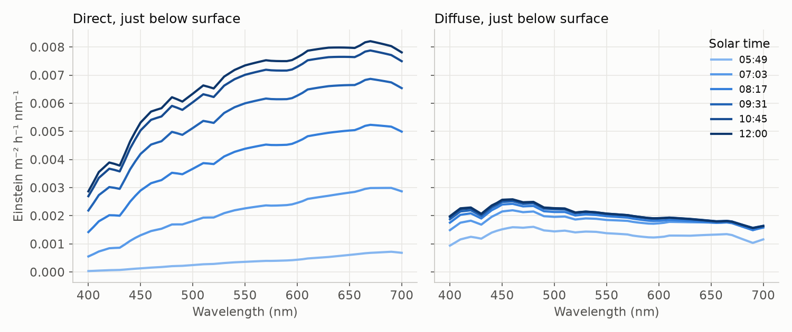

# Sunlight at the sea surface

Satellite PAR products give the **daily integral** of photosynthetically
available radiation (400–700 nm) above the sea surface, in
einstein m⁻² d⁻¹ (for example the MODIS/VIIRS PAR product,
[Frouin et al. 2003](../references.md#frouin2003)). The production model
needs the **instantaneous spectral** irradiance just *below* the surface,
split into a direct (sun) and a diffuse (sky) component, because they
penetrate the water at different angles. `surface_light.instant` builds this
in the steps below.

## 1. Solar geometry

All times are local solar time (`daylight` module).

**Declination** from the Fourier series of
[Spencer (1971)](../references.md#spencer1971), with day angle
$\Gamma = 2\pi d/365$:

$$
\delta = 0.006918 - 0.399912\cos\Gamma + 0.070257\sin\Gamma
       - 0.006758\cos 2\Gamma + 0.000907\sin 2\Gamma
       - 0.002697\cos 3\Gamma + 0.001480\sin 3\Gamma.
$$

**Solar zenith angle** at latitude $\phi$ and hour angle
$h = \pi(t-12)/12$ ([Iqbal 1983](../references.md#iqbal1983)):

$$
\cos\theta_s = \sin\delta\sin\phi + \cos\delta\cos\phi\cos h.
$$

**Sunrise** from $\cos h_0 = -\tan\phi\tan\delta$, and the time at which the
sun reaches a given zenith angle (`daylight.zenith_time`) by inverting the
equation above. The model integrates production from the time when
$\theta_s = 80^\circ$ in the morning to the matching time in the afternoon,
where the plane-parallel atmosphere is a good approximation.

**Day length** follows the model of [Brock (1981)](../references.md#brock1981)
(compared with alternatives by [Forsythe et al. 1995](../references.md#forsythe1995)):

$$
D = \frac{2}{15^\circ}\arccos(-\tan\phi\tan\delta')\ \text{h},\qquad
\delta' = 23.45^\circ\sin\!\left[\frac{360^\circ(283+d)}{365}\right].
$$

Polar day and night give $D = 24$ h and $D = 0$.

## 2. Clear-sky spectral irradiance

The spectral shape comes from the simple clear-sky model of
[Bird (1984)](../references.md#bird1984) and
[Bird & Riordan (1986)](../references.md#bird1986), as used in ocean optics
by [Sathyendranath & Platt (1988)](../references.md#sathyendranath1988) and
[Gregg & Carder (1990)](../references.md#gregg1990). The extraterrestrial
spectrum $H_0(\lambda)$ is attenuated by a product of transmittances, each a
function of the relative air mass
$M = [\cos\theta_s + 0.15(93.885-\theta_s)^{-1.253}]^{-1}$
([Kasten 1966](../references.md#kasten1966)):

| Process | Transmittance | Source |
|---|---|---|
| Rayleigh scattering | $T_r = \exp[-M/(\lambda^4(115.6406 - 1.335/\lambda^2))]$ | [Leckner 1978](../references.md#leckner1978) |
| Aerosols | $T_a = \exp(-\beta\lambda^{-\alpha}M)$, two Ångström regimes | [Bird & Riordan 1986](../references.md#bird1986) |
| Water vapour (2 cm) | $T_w = \exp[-0.3285 a_v W' M/(1+20.07a_vM)^{0.45}]$ | [Leckner 1978](../references.md#leckner1978) |
| Ozone (0.344 atm cm) | $T_o = \exp(-a_o H_o M_o)$, $M_o = 35/(1224\cos^2\theta_s+1)^{1/2}$ | [Paltridge & Platt 1976](../references.md#paltridge1976) |
| Mixed gases | $T_u = \exp[-1.41a_uM/(1+118.3a_uM)^{0.45}]$ | [Leckner 1978](../references.md#leckner1978) |

with $\lambda$ in µm. The **direct-normal** irradiance is

$$
E_\text{dir}(\lambda) = H_0\,T_r\,T_a\,T_w\,T_o\,[T_u],
$$

and the **diffuse** irradiance is the sum of Rayleigh- and aerosol-scattered
light, corrected by Bird's empirical factors $C(\lambda,\theta_s)$, plus
multiple reflections between the sea (albedo 0.05) and the sky (albedo
$\rho_s$):

$$
E_\text{dif} = C\,(I_r + I_a) + \frac{[E_\text{dir}\cos\theta_s + C(I_r+I_a)]\rho_s r_g}{1-\rho_s r_g}.
$$

The spectrum is scaled by the top-of-atmosphere irradiance relative to the
solar constant (1353 W m⁻²;
[Thekaekara & Drummond 1971](../references.md#thekaekara1971)). Full
expressions are in the [`irradiance` API](../api/irradiance.md).

## 3. Clouds

With cloud cover $c$ (fraction), the direct beam is reduced by $(1-c)$ and
the diffuse component is adjusted so that the total is the clear-sky total
multiplied by

$$
F = \frac{(1-0.5c)\,[0.82 - \alpha(1-c)]}{0.82-\alpha},\qquad
\alpha = \frac{0.28}{1+6.43\cos\theta_s}.
$$

Because the result is later rescaled to satellite PAR (step 6), cloud cover
only changes the **direct/diffuse partition** and the spectral shape, not the
total light.

## 4. From energy to quanta

Photosynthesis responds to photons, not energy. Spectral irradiance in
W m⁻² µm⁻¹ is converted to einstein m⁻² h⁻¹ nm⁻¹ with
$E_\text{photon} = hc/\lambda$:

$$
E_q(\lambda) = E(\lambda)\,\frac{\lambda\,[\text{nm}]\times 3600}{hc\,N_A\times 10^{12}}
            = E(\lambda)\,\frac{36\,\lambda}{19.87\times 6.022\times 10^{7}},
$$

see [Morel & Smith (1974)](../references.md#morel1974). The direct beam is
projected onto a horizontal surface by multiplying by $\cos\theta_s$.

## 5. Transmission through the sea surface

Snell's law gives the in-water angle, $\sin\theta_w = \sin\theta_s/1.333$. The
direct beam loses the Fresnel reflectance for unpolarised light,

$$
r = \frac12\frac{\sin^2(\theta_s-\theta_w)}{\sin^2(\theta_s+\theta_w)}
  + \frac12\frac{\tan^2(\theta_s-\theta_w)}{\tan^2(\theta_s+\theta_w)},
$$

which is about 2 % for a high sun and rises steeply beyond
$\theta_s\approx 60^\circ$. Diffuse skylight loses a constant 5.5 %
([Kirk 2011](../references.md#kirk2011)).

## 6. Scaling to satellite PAR

Assuming a sinusoidal diurnal cycle, the noon irradiance consistent with the
daily PAR is

$$
I_m = \frac{\pi\,\text{PAR}}{2D},
\qquad
I(t) = I_m\sin\!\left(\pi\frac{t - t_\text{rise}}{D}\right),
$$

([Platt & Sathyendranath 1988](../references.md#platt1988);
[Platt et al. 1990](../references.md#platt1990)). Both below-surface
components are multiplied by $I(t)$ divided by the spectrally integrated
*above*-surface model irradiance. The clear-sky model thus supplies only the
spectral shape and the direct/diffuse partition, and the observed PAR sets
the magnitude.

{ .figure }

*Direct and diffuse spectral irradiance just below the surface at 45° N on
6 May with a daily PAR of 25 einstein m⁻² d⁻¹, from the 80° zenith time to
noon. The direct component dominates and is redder at low sun angles.*
